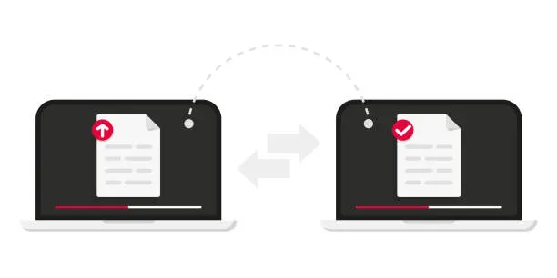

<div align="center">



# Secure File Sharing System (SFSS)

**Share files directly between trusted Windows PCs on a local network.**


</div>

SFSS is a peer-to-peer desktop application built in C++17. Each logged-in
instance listens for incoming file offers and can also send files to another
peer. No central file-transfer server or account service is used.

> **College demonstration project:** XOR file transformation and the included
> password hashing are not production security. Use only with trusted peers
> and non-sensitive files on a trusted LAN.

## What it can do

| Account and access | File transfer |
| --- | --- |
| Register, log in, and log out | Send directly over TCP |
| Separate local account on each PC | Accept or reject incoming requests |
| Verify a shared session key | Show progress and allow cancellation |
| Check peer reachability | Save received files and record history |
| Search and view transfer history | Detect disconnects and report errors |

## Run it

### Use the ready-to-run app

1. Copy `SecureShare.exe` to a writable folder on each Windows 10/11 PC.
2. Run it. The receiving PC does not need MinGW installed.
3. Follow [the two-PC setup](#send-a-file-between-two-pcs) below.

The app stores `data/` and `received/` beside its executable. Each computer has
its own accounts and transfer history.

### Build from source

**Requirements:** Windows 10/11, MinGW g++ with C++17 support, `mingw32-make`,
and `windres` (included with MinGW).

Run these commands in PowerShell from the project folder:

```powershell
mingw32-make clean
mingw32-make
.\SecureShare.exe
```

The Windows app icon is built from `assets/secureshare.ico`. The app statically
links the MinGW C++ runtime, so MinGW is not needed on the second PC.

Run the C++ integration test with:

```powershell
mingw32-make test
```

## Send a file between two PCs

Both computers must be on a network that permits devices to connect to each
other. These steps assume one sender and one receiver.

1. **Start both apps.** Register a separate account on each PC, then log in.
   Usernames allow letters, digits, `_`, and `-`; passwords must be at least
   eight characters.
2. **Set the listening port.** Use the default `54000` on both PCs. The same
   port can be used because they are separate computers. Confirm each app is
   online after login.
3. **Find the receiver's IPv4 address.** On the receiver, open Command Prompt,
   run `ipconfig`, and note the IPv4 address under the active Wi-Fi or Ethernet
   adapter. Use this address on the sender—not `127.0.0.1`.
4. **Allow inbound traffic on the receiver.** Permit Secure Share or inbound
   TCP port `54000` through Windows Firewall for a trusted network profile.
   Do not turn off the firewall or mark an untrusted network as Private.
5. **Fill in the sender's fields:** the receiver's username, current IPv4
   address, and listening port. Enter a shared session key of at least eight
   characters, choose a file with **Browse...**, and click **Send file**.
6. **Accept on the receiver.** Enter the exact same session key, click
   **Incoming requests**, check the sender and file details, and choose **Yes**
   to accept. Keep both apps open until the transfer finishes.

The receiver gets a success message with the saved path. Files are stored in
`received/` beside the receiver's `SecureShare.exe`. Start with a small file;
the current transfer limit is **64 MiB**.

<details>
<summary><strong>Connection and transfer troubleshooting</strong></summary>

- **No incoming request:** The receiver only lists requests that have arrived.
  Check that the sender can connect first.
- **Winsock error 10060 / timeout:** Confirm the receiver is logged in, the
  sender is using the receiver's current IPv4 address and exact listening
  port, the firewall allows inbound TCP, and the Wi-Fi allows devices to
  communicate.
- **Check the connection from the sender:** In PowerShell, replace the example
  IP with the receiver's actual IPv4 address:
  ```powershell
  Test-NetConnection 192.168.1.25 -Port 54000
  ```
  `TcpTestSucceeded : True` means TCP connectivity works. `False` means the
  request cannot reach the receiver yet.
- **Session key did not match:** Enter the exact same case-sensitive key on
  both PCs. The request remains pending so the receiver can try again.
- **Port already in use:** Pick another port when logging in on that PC, allow
  that TCP port through the firewall, and enter the same port on the sender.
- **Still cannot connect:** Guest Wi-Fi, client isolation, VPNs, or different
  network segments may block peer-to-peer traffic. This app is for a trusted
  LAN demo, not Internet file sharing.

</details>

## How the code is organized

| Folder | Responsibility |
| --- | --- |
| `src/` and `include/` | C++ application, GUI, and module implementations/interfaces |
| `src/auth/`, `include/auth/` | User accounts, registration, and authentication |
| `src/network/`, `include/network/` | Winsock client/server and shared TCP protocol |
| `src/security/`, `include/security/` | File handling, hashing, session proof, and demo cipher |
| `src/transfer/`, `include/transfer/` | Transfer workflow and history |
| `tests/` | C++ integration test for authentication and peer transfers |
| `assets/`, `resources/` | App icon and Windows executable resource declaration |
| `data/`, `received/` | Local runtime accounts/history and received files |

## Test coverage

`tests/integration.cpp` checks registration and login, invalid passwords,
session-key verification, an accepted 180,000-byte TCP transfer and byte
integrity, rejected requests, and sender/receiver history entries. It runs both
test peers locally; it does not replace testing across two physical PCs.

## Security limitations

- The file cipher is XOR and is **not secure encryption**.
- Password hashing is demonstration-grade, not a modern password KDF.
- The shared key and peer address are exchanged out of band.
- Do not use SFSS for sensitive files or over an untrusted network.
